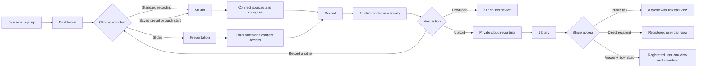

# RecordWeb Current UX Flow

```yaml
document_version: 1.0
status: current-as-implemented
captured_at: 2026-10-19
repository_commit: 6f22c6f
scope: authenticated website, public share page, and browser-local recovery
routes:
  - /sign-in
  - /sign-up
  - /dashboard
  - /
  - /presentation
  - /library
  - /settings
  - /share/[recordingId]
```

## 1. Purpose

This document describes how a person currently moves through RecordWeb, from authentication and recording setup to local review, cloud upload, sharing, playback, and recovery.

The flow is documented from the implemented routes, components, state transitions, and authorization checks. It describes current behavior rather than a proposed redesign. `docs/system_architecture.md` is intentionally not used because it is a legacy snapshot.

## 2. Experience at a glance



The default privacy model is client-first:

- Media capture, effects, audio processing, encoding, and recording happen in the browser.
- A completed recording is saved locally in the current browser profile.
- The recording leaves the device only when the user selects **Upload to cloud**.
- A newly uploaded recording is private until the owner enables a public link or grants a registered user access.

## 3. Entry, authentication, and global navigation

### 3.1 Authentication

All workspace routes require a Clerk session. An unauthenticated visitor is directed through Clerk's sign-in flow. Registration is available through `/sign-up`.

The public exception is `/share/[recordingId]`, but the recording is still shown only when at least one of these conditions is true:

- the recording has a public link;
- the signed-in visitor owns it; or
- the signed-in visitor has a direct share grant.

An inaccessible or unknown recording returns the not-found experience without revealing its metadata.

### 3.2 Primary navigation

The authenticated app navigation exposes:

| Destination | Route | User purpose |
| --- | --- | --- |
| Studio | `/` | Record a screen, camera, or screen-with-camera session. |
| Presentation | `/presentation` | Record a local PDF/PPTX lecture inside RecordWeb. |
| Dashboard | `/dashboard` | Review workspace totals, start a workflow, use a preset, or resume recovery. |
| Library | `/library` | Manage local, owned-cloud, and shared recordings. |
| Settings | `/settings` | Select a theme, inspect browser storage, and run service checks. |

The user avatar provides Clerk account controls. On smaller viewports the navigation changes from a sidebar to a bottom navigation bar.

### 3.3 Global device control

Whenever the screen, camera, or microphone remains active, a movable **Devices in use** panel appears across routes. The user can disconnect one source or choose **Disconnect all**. Its position is saved in the browser and can be reset.

## 4. Dashboard flow

The Dashboard is the main overview and shortcut surface.

1. The app loads cloud recordings and saved presets, then inspects local recordings and interrupted drafts in IndexedDB.
2. Summary cards show cloud recording count, local recording count, cloud file metadata size, and preset count.
3. If interrupted drafts exist, a recovery banner directs the user to **Recover in Studio**.
4. **New recording** opens the standard Studio with its current defaults.
5. A Quick start card writes a recommended setup and opens the Studio. Current quick starts are:
   - Presentation
   - Coding tutorial
   - Webcam message
   - Product demo
   - Online lecture
6. Selecting **Use** on a saved preset opens Studio and applies its camera frame, size, background, audio mode, and resolution.
7. Recent cloud recordings open their authorized share page.
8. A saved preset can be deleted after confirmation.

Important distinction: the Dashboard quick start named **Presentation** configures a standard screen-and-camera Studio session. The dedicated slide workflow is the separate **Presentation** navigation item at `/presentation`.

## 5. Standard Studio recording flow

### 5.1 Configure the session

The Studio opens in `setup` state and divides configuration into Sources, the central preview, and Effects.

1. Choose a capture mode:
   - **Studio** — screen plus camera;
   - **Screen** — display only;
   - **Camera** — webcam only.
2. Choose the camera and microphone devices.
3. For a Google Slides workflow, paste a `docs.google.com/presentation` URL and select **Connect sources**. The extension matches by presentation ID across `/edit`, `/view`, `/preview`, `/present`, account prefixes, and query parameters. When an editable matching tab exists, the extension navigates that same tab ID to `/present` in the background; otherwise it opens a new background presentation tab. Published presentation URLs remain unchanged.
4. Connect waits for the Slides cursor tracker to report `TARGET_READY`, then immediately opens Chrome's native share picker. Select the prepared Google Slides tab; choosing a window or entire screen is rejected. Camera and microphone permission may follow.
5. Confirm the live Slides preview plus camera, microphone, tab-video, system-audio, and cursor-target readiness.
6. Choose either 720p or 1080p output. Both use a 16:9 frame, target 30 FPS, and have a 30-minute maximum active duration.

Setup remains in RecordWeb while the Slides target is prepared in the background. The pre-session **Ready to record** / **Continue in RecordWeb** module is retained behind an extension feature flag but is not rendered in the current flow. The Connect gesture owns the native `getDisplayMedia()` request and the resulting stream drives the Studio live preview before recording.

If the extension capture path is unavailable and the legacy helper is present, the UI can fall back to native screen selection plus a legacy cursor display selection.

### 5.2 Configure camera, audio, and presets

The Effects panel contains three tabs:

- **Camera**: original, blurred, or cutout background; circle, rounded, or cutout frame; four anchor positions; and small, medium, or large size. The camera overlay can also be dragged in the preview or moved with arrow keys when focused.
- **Audio**: Natural, Voice clarity, Noise reduction, Podcast, or Custom DSP; microphone gain; and system-audio gain when tab audio is present.
- **Preset**: save the current setup to the signed-in account or load one of the available presets.

The user may open **Diagnostics** before recording to check the Clerk session, Neon, Vercel Blob configuration, screen capture, camera/microphone access, MediaRecorder, IndexedDB, and direct file-save support.

### 5.3 Record

```mermaid
stateDiagram-v2
    [*] --> Setup
    Setup --> Countdown: Start recording and source is ready
    Setup --> Setup: Start blocked; show source guidance
    Countdown --> Recording: 3-2-1 completes
    Recording --> Paused: Pause or Space / Alt+P
    Paused --> Recording: Resume or Space / Alt+P
    Recording --> Processing: Stop or Alt+S
    Paused --> Processing: Stop or Alt+S
    Processing --> Review: Finalization succeeds
    Processing --> Setup: Finalization fails
    Review --> Setup: Record another
```



1. Select **Start recording** after the live preview is ready. Start reuses the tab stream acquired by Connect and does not open the share picker again.
2. If no usable video source or cursor target is ready, recording stays in setup and the Sources panel reopens with guidance.
3. The app resumes browser audio if needed, closes the side panels, and shows a three-second countdown.
4. The app starts the recorders and automatically focuses the prepared Slides tab. A compact **Recording** pill appears in the bottom-right corner only while recording. Hovering or clicking expands pause/resume, microphone, camera, and **End session** controls; it auto-collapses after inactivity and follows Slides into browser fullscreen. The overlay is part of the shared tab, so it appears in captured video while visible.
5. **End session** hides the overlay immediately, stops and finalizes all recording assets (including cursor JSON), then disconnects the prepared Slides target and every owned media source. A normal Stop returns to RecordWeb but keeps camera and microphone available for another take. `Alt+P`, `Alt+S`, `Alt+M`, and `Alt+C` remain available as low-visual-impact controls.
6. During recording, the control dock shows elapsed time and exposes pause/resume, stop, microphone mute, and camera visibility controls.
7. The session is checkpointed to IndexedDB while recording.
8. Select Stop, press `Alt+S`, or reach the 30-minute limit to finalize the session.
9. The UI enters **Finalizing** while it repairs and prepares the recorded assets, stops the native display stream, then opens Review.

Keyboard controls outside form fields:

| Shortcut | Action |
| --- | --- |
| `Space` or `Alt+P` | Pause or resume while recording. |
| `Alt+S` | Stop and finalize. |
| `Alt+M` | Toggle microphone mute. |
| `Alt+C` | Toggle camera visibility. |

## 6. Presentation recording flow

The Presentation workspace is designed for local PDF and PPTX files and uses a different visual capture path from the standard Studio.

### 6.1 Prepare slides and devices

1. Open `/presentation` from the main navigation.
2. Select **Choose PDF or PPTX**.
3. The file is validated and rendered locally. Current limits are 50 MB and 300 slides.
4. Optionally connect a camera and microphone. The raw webcam appears over the rendered slide when enabled.
5. Choose 720p or 1080p output and configure audio or presets from the Effects panel.
6. Move between slides with the on-screen controls, `Left`/`Right`, or `Page Up`/`Page Down`.
7. PDF pages expose embedded links and selectable text above the rendered canvas. External links open in a new tab, internal destinations move to the referenced PDF page, and dragged text uses the browser's temporary selection highlight. Scanned/image-only PDFs have no selectable text, and selections are not saved as PDF annotations.

The slide file remains local in the browser. While still in setup, it can be replaced with **Replace file**.

### 6.2 Start and capture

1. **Start presentation** remains disabled until the deck is ready.
2. Starting asks the browser for current-tab capture.
3. In the browser picker, the user must explicitly choose **This Tab**. RecordWeb cannot select it silently.
4. When supported, capture is restricted to the presentation area. Otherwise the app uses a clean full-tab fallback and shows a warning.
5. After capture begins, the same countdown, recording, pause/resume, stop, finalization, and Review states used by Studio apply.
6. The rendered slide, raw webcam, and custom cursor are the visible presentation content. MediaPipe background removal is not part of this mode.
7. After a deck is loaded, **Full screen presentation** (or `Shift+F`) places the presentation capture area itself in browser fullscreen. The same slide, webcam, and custom-cursor DOM root remains mounted, so capture and normalized cursor tracking continue without changing sources. Press `Escape` or `Shift+F` to leave fullscreen.

Choosing **Record another** after review also clears the previous presentation deck, returning the presentation workspace to its empty state.

## 7. Review, local download, and cloud upload

After successful finalization, Review shows:

- the composite video player;
- mixed, microphone, and system-audio waveforms when those assets exist;
- the recorded cursor trajectory player when cursor data exists;
- session duration, resolution, and target frame rate; and
- a count of available recording files.

The user then chooses one of three paths:

### 7.1 Download locally

**Download all files** creates one browser-generated ZIP containing the composite and every available separate source. The archive is produced on the client and is not sent through a server route.

### 7.2 Upload to cloud

1. Select **Upload to cloud**.
2. The browser uploads the composite and available source assets directly to Vercel Blob and displays aggregate progress.
3. After the files finish, the UI changes to **Saving metadata…** while Neon metadata is created.
4. The resulting cloud recording is private by default.
5. The primary action changes to **Make public & copy link**. Selecting it enables public access and copies the share URL.

If upload or metadata creation fails, the local recording remains available and Review reports the cloud-save error.

### 7.3 Start again

**Record another** resets the Review state and returns to setup. In Presentation, it also unloads the deck.

## 8. Recovery flow

RecordWeb stores rolling recovery checkpoints in IndexedDB.

1. The Dashboard reports the number of interrupted sessions and links to Studio.
2. Studio displays a session notice when recoverable drafts exist.
3. Select **Recover latest** to rebuild the newest draft.
4. WebM media is repaired for seekable playback when needed.
5. A successful recovery becomes a finalized local recording, deletes its draft checkpoint, and opens Review.
6. From Review, the user can download the assets, upload them, or record another session.

Recovery is browser-profile-specific. Clearing site data removes drafts and local recordings that were not downloaded or uploaded.

## 9. Library flow

The Library loads local recordings, cloud recordings owned by the current user, and cloud recordings shared with the current user.

### 9.1 Filters

| Filter | Contents |
| --- | --- |
| Mine | Owned cloud recordings plus local recordings that do not already have a cloud counterpart. |
| Shared with me | Recordings directly shared with the signed-in user. |
| Local only | Final recordings stored only in this browser. |
| Cloud | Cloud recordings owned by the signed-in user. |

**Refresh** reloads all sources. **New recording** returns to Studio.

### 9.2 Local recording actions

A local card supports:

- Preview;
- audio waveform playback when available;
- **All files ZIP**;
- **Open cursor** when a cursor asset exists; and
- **Delete local**, with confirmation.

Deleting a local copy does not delete an uploaded cloud copy.

### 9.3 Owned cloud recording actions

An owned cloud card supports:

- Open the share page;
- manage direct recipients in **Share**;
- download all available files as a ZIP;
- open the cursor player when available;
- switch between public and private access; and
- permanently delete the cloud recording, its Blob assets, and all share grants after confirmation.

The Share dialog allows the owner to:

1. enable or disable the public link;
2. copy the public link when enabled;
3. enter a registered user's email;
4. grant either **Viewer** or **Viewer + download** access; and
5. review or revoke existing recipients.

### 9.4 Shared recording actions

A directly shared card identifies the owner and the granted permission:

- **View only** can open and play the recording but does not receive download controls.
- **View + download** can open, download the archive, and use the cursor player when those assets exist.

## 10. Share-page flow

The share page performs its authorization check for every request.

1. The visitor opens `/share/[recordingId]`.
2. The server resolves access as owner, public, viewer, or viewer-with-download.
3. If access is valid, the page shows the title, duration, resolution, FPS, creation date, and video player.
4. Owners and `viewer_download` recipients can download the primary video and the available multi-file ZIP.
5. Public and view-only visitors receive playback without RecordWeb download controls.
6. If no uploaded video exists, the page explains that playback is unavailable.

WebM recordings include a compatibility note because playback can vary on older Safari and iOS versions.

## 11. Settings flow

Settings contains four user-facing areas:

- **Color theme**: choose Dark studio or Light workspace. The choice is saved locally and applied across the app.
- **Local recordings**: see finalized recording count, recovery draft count, and local finalized-media size.
- **Service connections**: run an authenticated check for Clerk, Neon, and Vercel Blob.
- **Privacy model**: review where capture, recovery, upload, and sharing data are handled.

## 12. Important current states and feedback

| Area | State or condition | User-facing response |
| --- | --- | --- |
| Source setup | Browser is requesting permission | Connect action changes to **Requesting access…**. |
| Source setup | Required video source is missing | Start is blocked and guidance appears in the session notice/Sources panel. |
| Audio | Browser AudioContext is suspended | Audio meter offers a resume action. |
| Recording | Countdown | Large countdown overlay appears over the preview. |
| Recording | Paused | Session label and central control change to Resume. |
| Recording | Processing | Recording controls are disabled while assets finalize. |
| Upload | Uploading | Aggregate percentage and progress bar are shown. |
| Upload | Saving metadata | Primary action reports **Saving metadata…**. |
| Recovery | Draft found | Dashboard and Studio expose recovery entry points. |
| Library | Empty filter | The user is prompted to record locally or choose another filter. |
| Share | Unauthorized or missing | Not-found response; recording metadata is not rendered. |
| Cloud configuration | Database unavailable | Share page reports that sharing is temporarily unavailable. |

## 13. Current constraints users should know

- Google Slides cursor tracking requires only the one-time extension installation. Each new recording still requires explicit selection of the prepared Slides tab in Chrome's native share picker because display-capture permission cannot be persisted.
- Presentation capture still requires the browser's explicit **This Tab** selection.
- A recording has a maximum active duration of 30 minutes.
- Browser-local recordings and recovery drafts belong to the current browser profile and can be removed by clearing site data.
- Upload is optional and explicit; a successful upload starts private.
- The current Vercel Blob objects use public URLs underneath the app's page-level access model. Sensitive recordings should not be uploaded until private object delivery is implemented.
- Disconnecting a device is separate from stopping a recording. The global device panel indicates any source that remains active.
- Real-browser runtime verification of the Presentation path and the full extension lifecycle is still pending.

## 14. Implementation evidence

Primary UX evidence was verified in:

- `src/proxy.ts`
- `src/app/layout.tsx`
- `src/components/app/AppNavigation.tsx`
- `src/components/dashboard/DashboardClient.tsx`
- `src/components/studio/StudioShell.tsx`
- `src/components/studio/PresentationShell.tsx`
- `src/components/studio/StudioSourcesPanel.tsx`
- `src/components/studio/PresentationSourcesPanel.tsx`
- `src/components/studio/StudioStage.tsx`
- `src/components/studio/PresentationStage.tsx`
- `src/components/studio/StudioEffectsPanel.tsx`
- `src/components/studio/StudioReviewWorkspace.tsx`
- `src/components/studio/useStudioController.ts`
- `src/components/library/LibraryClient.tsx`
- `src/components/settings/SettingsClient.tsx`
- `src/app/share/[recordingId]/page.tsx`
- `src/components/media/GlobalMediaControl.tsx`

Maintained supporting documents:

- `docs/ui_rebuild_impact_analysis.md`
- `docs/audio_video_pipeline.md`
- `MEMORY.md`

