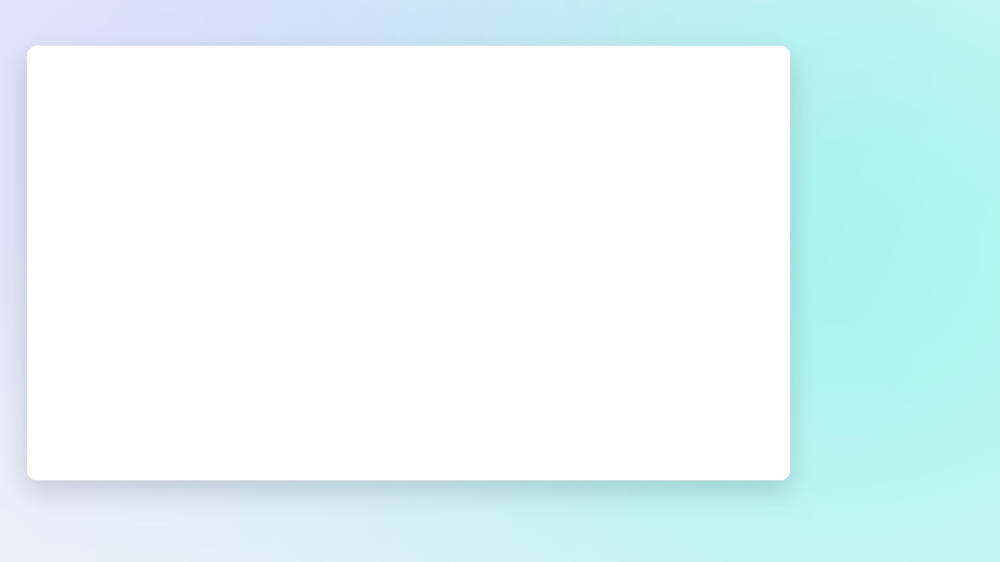

Tạo thêm 1 page dùng để lấy các data về teacher để phục vụ cho việc calibrate các video được record.

Cụ thể data ở đây là gì?
Tôi sẽ cần chia màn hình thành một lưới 3x3 gồm 9 ô. Và cần cầu chụp và lưu trữ hình ảnh posture của người dùng khi đứng chỉ tay vào từng ô trong 9 ô đó. tức là cần lưu trữ 9 posture.

Để người dùng có thể thấy được hình ảnh của họ khi chụp hình thì tôi thiết kế một layout sau: 
- Khoảng trắng bên trái sẽ hiện ra lưới và target cell mà người dùng cần trỏ tay vào.
Còn khoảng trống xanh bên phải là để hiện hình ảnh webcam của người đó.
- Tôi cần scale ảnh webcam của người đó (từ đầu đến chân) về với độ cao bằng với cái khung dọc của khoảng trắng. Sử dụng mediaPipe cho việc detect body và xoá background, sau đó scale ảnh về khung trong layout.

