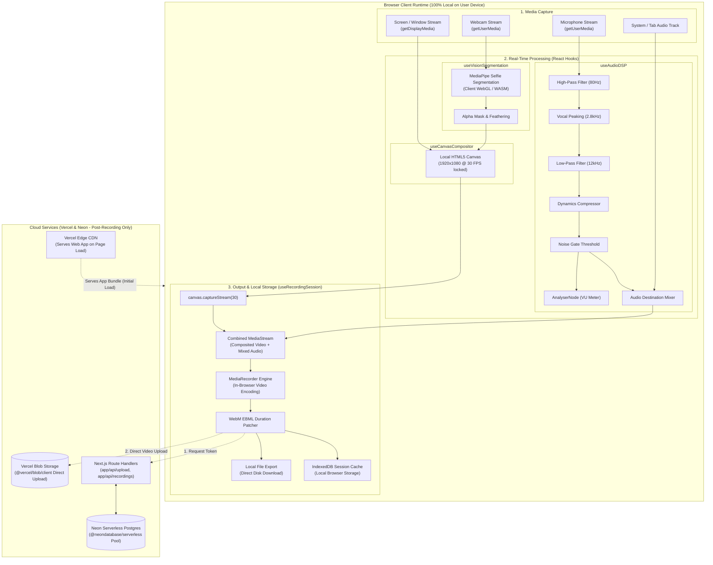

# System Architecture & Technical Design

## 1. High-Level Architecture Overview

RecordWeb is built with **Next.js (App Router)**, **React**, and **TypeScript**, operating via a high-performance hybrid architecture:
- **Client-Side Core (React + TypeScript)**: 100% of real-time media acquisition, WebGL neural vision segmentation, Web Audio DSP filtering, 30 FPS canvas compositing, and WebM encoding run locally inside the user's browser for zero latency and privacy.
- **Serverless Cloud Layer (Next.js Route Handlers + Vercel)**: Hosted on **Vercel** with Next.js App Router API handlers (`src/app/api/*`) connected to **Neon Serverless Postgres** for recording metadata and **Vercel Blob** for direct client-to-edge video object storage.



---

## 2. Core Architectural Subsystems

### 2.1 Media Acquisition Hook (`useMediaDevices.ts`)
* **Role**: Initializes, configures, and monitors hardware devices (cameras, displays, microphones).
* **Key Responsibilities**:
  * Requesting screen capture with custom resolution preferences (`1920x1080` standard, frame rate `30fps`).
  * Requesting camera capture with user-selected video inputs (`deviceId`).
  * Requesting microphone stream with configurable audio constraints (`echoCancellation`, `noiseSuppression`, `autoGainControl`).
  * Handling device hot-plugging, permission revocations, and track `ended` events (e.g. user clicking "Stop Sharing" on Chrome's floating bar).
  * Strict memory cleanup: invoking `track.stop()` on unmount or stream re-acquisition.

### 2.2 Visual Compositing Engine (`useCanvasCompositor.ts`)
* **Role**: Blends multiple video feeds into a single coherent 30fps video stream.
* **Layout Modes**:
  1. **Screen Only**: Screen feed scaled to canvas preserving aspect ratio with letterboxing/pillarboxing if needed.
  2. **Webcam Only**: Centered camera feed with optional background blur or virtual background.
  3. **Picture-in-Picture (PiP Studio)**: Full-size screen capture with overlay camera bubble.
     * Shape: Circular badge, rounded rectangle, or cutout silhouette (AI background removed).
     * Position: Configurable (Bottom-Right, Bottom-Left, Top-Right, Top-Left, or custom drag position).
     * Sizing: Small (160px), Medium (240px), Large (320px).
* **Render Loop**:
  * Employs `requestAnimationFrame` with precise timestamp delta enforcement to guarantee a steady 30 FPS.
  * Outputs via `canvas.captureStream(30)`.

### 2.3 Neural Vision & Segmentation Engine (`useVisionSegmentation.ts`)
* **Role**: Extracts the human silhouette from the webcam feed in real time.
* **Technology**: MediaPipe Selfie Segmentation model running client-side via WebGL/WASM.
* **Operational Modes**:
  * **Original**: Unaltered webcam feed.
  * **Background Blur**: Blurs pixels outside the subject mask using canvas filter `blur(12px)`.
  * **Background Removal (Transparent PiP)**: Masks out background pixels completely, rendering the subject floating directly above screen content.
  * **Virtual Background**: Draws custom image, gradient, or solid color behind the subject mask.

### 2.4 Web Audio DSP Pipeline (`useAudioDSP.ts`)
* **Role**: Mixes, filters, enhances, and analyzes audio signals before recording.
* **Node Topology**:
  ```
  MicInput 
    └─► BiquadFilter (High-pass 80Hz) 
          └─► BiquadFilter (Peaking 2.8kHz +4dB) 
                └─► BiquadFilter (Low-pass 12kHz) 
                      └─► DynamicsCompressorNode 
                            └─► NoiseGate (GainNode control) 
                                  ├─► AnalyserNode (Visualizer / VU Meter)
                                  └─► MasterAudioDestination (Mixer)
  
  SystemAudio (from getDisplayMedia)
    └─► GainNode (Volume adjustment)
          └─► MasterAudioDestination (Mixer)
  ```

### 2.5 Recording State Machine (`useRecordingSession.ts`)
* **State Transition Model**:


### 2.6 Persistence & Local Storage Subsystem (`idb.ts` & `ebmlPatcher.ts`)
* **Chunk Aggregation**: Gathers data chunks emitted during `mediaRecorder.ondataavailable` (emitted every 1000ms for safety).
* **Metadata Repair**: Standard browser `MediaRecorder` writes `Duration: 0` or NaN to WebM EBML headers for live streams. The patcher parses EBML elements and injects the exact recorded duration, making the resulting video fully seekable in all players.
* **Session Cache (IndexedDB)**: Stores the recorded blob in IndexedDB `RecordingsStore` with unique recording metadata to prevent accidental loss upon browser reload.
* **Direct Local Export**: Allows users to download the video file immediately to their local drive as `.webm`.

### 2.7 Cloud Video Storage Subsystem (Vercel Blob)
* **Role**: Object storage for hosting recorded video files and generating shareable playback links.
* **Direct Client Upload Architecture**:
  * Standard serverless functions have a 4.5MB request payload limit. Because recorded videos can reach 50MB - 150MB+, RecordWeb uses `@vercel/blob/client`.
  * **Upload Protocol**:
    1. Client invokes Next.js route `/api/upload` to request an authorized upload client token.
    2. Client streams the binary video blob directly from the browser to Vercel's global edge blob storage via `upload()` from `@vercel/blob/client`.
    3. Vercel Blob returns a permanent public HTTPS video URL.
    4. The resulting `storage_url` is stored in Neon Postgres alongside recording metadata.

### 2.8 Cloud Database Subsystem (Neon Serverless Postgres)
* **Role**: Relational database for recording metadata catalogs, studio presets, and share links.
* **Connection Strategy**:
  * Utilizes `@neondatabase/serverless` over WebSockets / HTTP pooling in `src/lib/db.ts`.
  * Auto-scales compute from zero with zero connection pool exhaustion.
* **Database Schema Design**:
  ```sql
  -- Recordings metadata table
  CREATE TABLE recordings (
      id UUID PRIMARY KEY DEFAULT gen_random_uuid(),
      title VARCHAR(255) NOT NULL,
      duration_seconds REAL NOT NULL,
      file_size_bytes BIGINT NOT NULL,
      resolution VARCHAR(32) NOT NULL DEFAULT '1920x1080',
      fps INTEGER NOT NULL DEFAULT 30,
      mime_type VARCHAR(64) NOT NULL DEFAULT 'video/webm',
      local_id VARCHAR(128),
      storage_url TEXT NULL,            -- Vercel Blob CDN public URL
      blob_pathname TEXT NULL,          -- Vercel Blob pathname for deletions
      settings JSONB DEFAULT '{}'::jsonb,
      created_at TIMESTAMP WITH TIME ZONE DEFAULT NOW()
  );

  -- Studio presets table
  CREATE TABLE studio_presets (
      id UUID PRIMARY KEY DEFAULT gen_random_uuid(),
      preset_name VARCHAR(100) NOT NULL,
      pip_shape VARCHAR(32) DEFAULT 'circle',
      pip_size VARCHAR(32) DEFAULT 'medium',
      pip_position VARCHAR(32) DEFAULT 'bottom-right',
      bg_removal_mode VARCHAR(32) DEFAULT 'blur',
      filters_config JSONB DEFAULT '{}'::jsonb,
      updated_at TIMESTAMP WITH TIME ZONE DEFAULT NOW()
  );
  ```

### 2.9 Next.js Project Structure & App Router Architecture

```text
src/
├── app/
│   ├── layout.tsx                    # Root layout with font and metadata
│   ├── page.tsx                      # Studio main page ("use client")
│   ├── globals.css                   # Glassmorphic design tokens and reset
│   └── api/
│       ├── upload/
│       │   └── route.ts              # Vercel Blob client upload token generation
│       ├── recordings/
│       │   └── route.ts              # Neon DB recording metadata CRUD
│       └── presets/
│           └── route.ts              # Neon DB studio presets CRUD
├── components/
│   ├── studio/
│   │   ├── StudioStage.tsx           # 16:9 Live Canvas preview + overlays
│   │   ├── ControlDock.tsx           # Floating REC bar, timer, pause/resume
│   │   ├── SourceSelector.tsx        # Screen / Camera / PiP selector
│   │   ├── FilterPanel.tsx           # DSP sound filter toggles and gain
│   │   ├── CameraSettings.tsx        # PiP shape, size, background mode
│   │   ├── VuMeter.tsx               # Audio levels visualizer
│   │   └── CountdownOverlay.tsx      # 3-2-1 animated countdown
│   └── review/
│       ├── ReviewModal.tsx           # Video playback player and export buttons
│       └── RecordingsDrawer.tsx      # Dual-tab local IndexedDB & cloud history
├── hooks/
│   ├── useMediaDevices.ts            # Screen & camera stream lifecycle
│   ├── useCanvasCompositor.ts        # 30 FPS composition loop & PiP layout
│   ├── useAudioDSP.ts                # Web Audio graph & DSP filtering
│   ├── useVisionSegmentation.ts      # MediaPipe AI background removal
│   └── useRecordingSession.ts        # MediaRecorder lifecycle & 5-min timer
├── lib/
│   ├── db.ts                         # Neon Postgres client via @neondatabase/serverless
│   ├── ebmlPatcher.ts                # Binary EBML duration patcher
│   └── idb.ts                        # IndexedDB wrapper for session backup
└── types/
    ├── media.ts                      # Stream and filter configuration types
    ├── recording.ts                  # Recording metadata and chunk types
    └── database.ts                   # Neon DB model interfaces
```

---

## 3. Data Flow & Latency Targets

| Pipeline Step | Target Latency / Cadence | Technique |
| :--- | :--- | :--- |
| Screen Capture Render | < 16ms | Direct Canvas `drawImage(videoElement)` |
| MediaPipe AI Segmentation | < 25ms per frame | Downscaled inference canvas (256x256), WebGL backend |
| Audio Filtering & Mixing | < 5ms | Native Web Audio API native thread |
| Canvas Stream Encoding | 30.0 FPS locked | Delta-timed RAF + `canvas.captureStream(30)` |
| Video Chunk Flush | Every 1,000ms | `mediaRecorder.start(1000)` |
| Duration Patcher | < 150ms post-stop | In-memory binary EBML buffer scan |
| Vercel Blob Upload | Bandwidth dependent | Direct client-to-edge stream via `@vercel/blob/client` |
| Neon DB Metadata Sync | < 100ms | HTTP connection pooling via `@neondatabase/serverless` |
