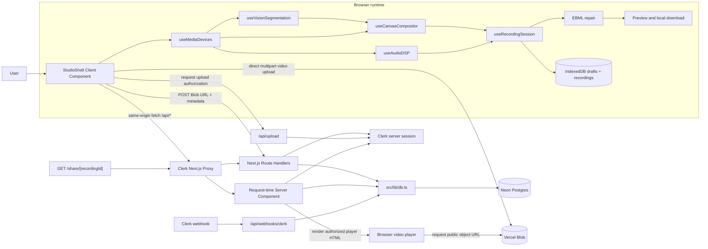
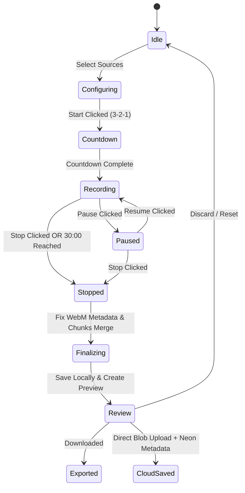
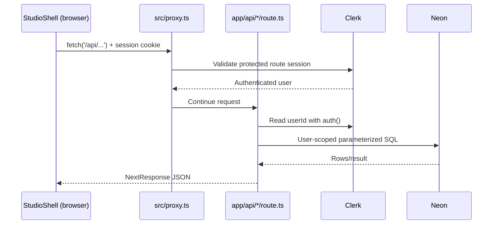
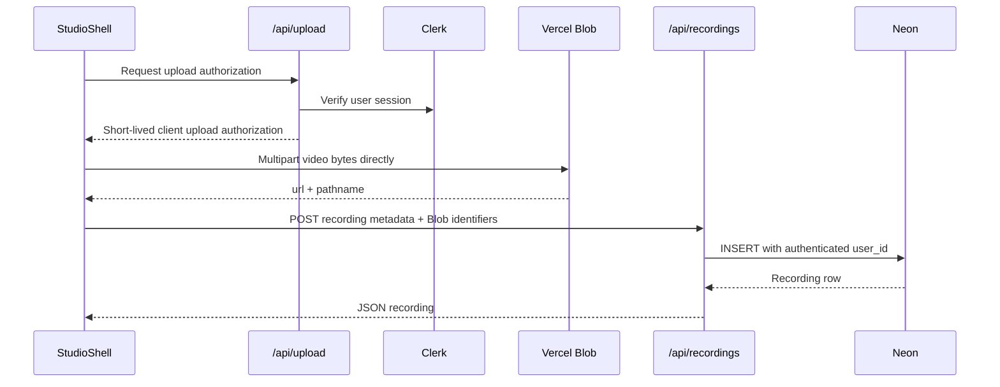

# System Architecture & Technical Design

## 1. High-Level Architecture Overview

RecordWeb is a full-stack **Next.js 16 App Router**, **React 19**, and **TypeScript** application. It does not have a separate Express or Nest backend. The browser application, request proxy, Server Components, and serverless Route Handlers live in this repository and deploy together on Vercel.

- **Browser client**: `StudioShell` coordinates all interactive UI and the custom media hooks. Screen/camera capture, MediaPipe segmentation, Web Audio DSP, 30 FPS canvas composition, MediaRecorder encoding, EBML repair, and IndexedDB recovery run on the user's device.
- **Request boundary**: `src/proxy.ts` uses Clerk to protect private pages and API routes before they execute. Public exceptions include sign-in/up, Clerk webhooks, the share page, and the Vercel Blob callback route.
- **Server application**: Next.js Route Handlers in `src/app/api/**/route.ts` implement health checks, preset CRUD, recording metadata CRUD, share grants, upload-token authorization, and Clerk user synchronization. The dynamic share page is a request-time Server Component with its own server-side access query.
- **Managed persistence**: Neon stores users, recording metadata, presets, and share grants. Vercel Blob stores video objects. IndexedDB stores local recording drafts and finalized local recordings.
- **Security boundary**: `DATABASE_URL`, `BLOB_READ_WRITE_TOKEN`, and Clerk server secrets are consumed only by server code. Client Components call same-origin APIs and never query Neon directly.



---

## 2. Core Architectural Subsystems

### 2.1 Media Acquisition Hook (`useMediaDevices.ts`)
* **Role**: Initializes, configures, and monitors hardware devices (cameras, displays, microphones).
* **Key Responsibilities**:
  * Requesting screen capture with custom resolution preferences (`1920x1080` standard, frame rate `30fps`).
  * Requesting camera capture with user-selected video inputs (`deviceId`).
  * Requesting microphone stream with configurable audio constraints (`echoCancellation`, `noiseSuppression`, `autoGainControl`).
  * Handling device hot-plugging, permission revocations, and track `ended` events (e.g. user clicking "Stop Sharing" on Chrome's floating bar).
  * Strict memory cleanup: invoking `track.stop()` on unmount or stream re-acquisition.

### 2.2 Visual Compositing Engine (`useCanvasCompositor.ts`)
* **Role**: Blends multiple video feeds into a single coherent 30fps video stream.
* **Layout Modes**:
  1. **Screen Only**: Screen feed scaled to canvas preserving aspect ratio with letterboxing/pillarboxing if needed.
  2. **Webcam Only**: Centered camera feed with optional background blur or transparent cutout.
  3. **Picture-in-Picture (PiP Studio)**: Full-size screen capture with overlay camera bubble.
     * Shape: Circular badge, rounded rectangle, or cutout silhouette (AI background removed).
     * Position: Configurable (Bottom-Right, Bottom-Left, Top-Right, Top-Left, or custom drag position).
     * Sizing: Small (160px), Medium (240px), Large (320px).
* **Render Loop**:
  * Employs `requestAnimationFrame` with precise **timestamp delta enforcement** to guarantee a steady 30 FPS.
  * Frame is only drawn when the accumulated delta exceeds 33.33ms — preventing unbounded renders and throttling when the tab is hidden.
  * Outputs via `canvas.captureStream(30)`.
* **Risk 2 Mitigation (Thread Overload)**:
  * MediaPipe inference runs on a **downscaled 256×256 offscreen canvas** via WebGL/WASM, separate from the main 1920×1080 compositing canvas.
  * If the main thread canvas causes stutter under profiling, migrate the render loop to an **`OffscreenCanvas` inside a dedicated Web Worker**, completely freeing the React UI thread.

### 2.3 Neural Vision & Segmentation Engine (`useVisionSegmentation.ts`)
* **Role**: Extracts the human silhouette from the webcam feed in real time.
* **Technology**: MediaPipe Selfie Segmentation model running client-side via WebGL/WASM.
* **Operational Modes**:
  * **Original**: Unaltered webcam feed.
  * **Background Blur**: Blurs pixels outside the subject mask using canvas filter `blur(12px)`.
  * **Background Removal (Transparent PiP)**: Masks out background pixels completely, rendering the subject floating directly above screen content.
* **Performance**: Inference canvas is always scaled to **256×256** before running segmentation. The resulting mask is upscaled and composited onto the full 1920×1080 canvas output.
* **Current boundary**: The shared `BackgroundRemovalMode` type still includes `virtual`, but the current Studio UI exposes only `original`, `blur`, and `cutout`; virtual-image backgrounds are not implemented.

### 2.4 Web Audio DSP Pipeline (`useAudioDSP.ts`)
* **Role**: Mixes, filters, enhances, and analyzes audio signals before recording.
* **Node Topology**:
  ```
  MicInput 
    └─► BiquadFilter (High-pass 80Hz) 
          └─► BiquadFilter (Peaking 2.8kHz +4dB) 
                └─► BiquadFilter (Low-pass 12kHz) 
                      └─► DynamicsCompressorNode 
                            └─► NoiseGate (GainNode — smooth setTargetAtTime)
                                  ├─► AnalyserNode (Visualizer / VU Meter)
                                  └─► MasterAudioDestination (Mixer)
  
  SystemAudio (from getDisplayMedia)
    └─► GainNode (Volume adjustment)
          └─► MasterAudioDestination (Mixer)
  ```
* **Risk 4 Mitigation (Noise Gate Popping)**:
  * Gate open (signal above threshold): `gainNode.gain.setTargetAtTime(1.0, ctx.currentTime, 0.010)` — ~10ms attack.
  * Gate close (signal below threshold): `gainNode.gain.setTargetAtTime(0.0, ctx.currentTime, 0.100)` — ~100ms release.
  * NEVER use `gain.value = 0` step changes — these cause sharp discontinuities that produce audible clicking/popping artifacts.

### 2.5 Recording State Machine (`useRecordingSession.ts`)
* **State Transition Model**:



* **Risk 3 Mitigation (A/V Desync over Long Recordings)**:
  * The canvas frame loop must be driven by a **steady delta-clamped RAF timer**. Raw `requestAnimationFrame` throttles when the browser tab is hidden, starving the canvas stream and causing video to fall behind audio.
  * A session timer fires `stopRecording()` hard at **30 minutes** to prevent unchecked clock drift.
  * UI prominently warns users when a session exceeds 15 minutes, recommending shorter sessions for best sync quality.

### 2.6 Persistence & Local Storage Subsystem (`idb.ts` & `ebmlPatcher.ts`)
* **Chunk Aggregation**: Gathers data chunks emitted during `mediaRecorder.ondataavailable` (emitted every 1000ms for safety).
* **Metadata Repair**: Standard browser `MediaRecorder` writes `Duration: 0` or NaN to WebM EBML headers for live streams. The patcher parses EBML elements and injects the exact recorded duration, making the resulting video fully seekable in all players.
* **Session Cache (IndexedDB)**: `src/lib/idb.ts` stores per-second drafts under `recordweb_draft_*` keys and finalized local recordings under `recordweb_rec_*` keys. The Studio detects drafts on load and can recover the newest draft.
* **Direct Local Export**: Allows users to download the finalized video as `.mp4` when the browser recorded MP4 or `.webm` when it used the WebM fallback.

### 2.7 Cloud Video Storage Subsystem (Vercel Blob)
* **Role**: Object storage for hosting recorded video files and generating shareable playback links.
* **Direct Client Upload Architecture**:
  * Standard serverless functions have a 4.5MB request payload limit. Because recorded videos can reach 50MB - 150MB+, RecordWeb uses `@vercel/blob/client`.
  * **Upload Protocol** (Risk 5 auth-gated):
    1. Client invokes Next.js route `/api/upload` with a valid auth session to request an authorized upload client token.
    2. Route Handler validates the user session and enforces per-user rate limits before issuing the token.
    3. Client streams the binary video blob directly from the browser to Vercel's global edge blob storage via `upload()` from `@vercel/blob/client`.
    4. Vercel Blob returns a permanent public HTTPS video URL.
    5. The resulting `storage_url` is stored in Neon Postgres alongside recording metadata.
* **Current upload guard**: `/api/upload` accepts MP4/WebM up to 300 MB and uses an in-memory limit of 10 token requests per user per hour. The limiter is instance-local and must be replaced by durable storage before multi-instance production scale.
* **Future Upgrade Path**: If Vercel Blob bandwidth costs grow, swap for **Cloudflare R2** via S3 presigned URLs (zero egress fees).

### 2.8 Cloud Database Subsystem (Neon Serverless Postgres)
* **Role**: Relational database for recording metadata catalogs, studio presets, and share links.
* **Connection Strategy**:
  * Utilizes `@neondatabase/serverless` over WebSockets / HTTP pooling in `src/lib/db.ts`.
  * Auto-scales compute from zero with zero connection pool exhaustion.
* **Database Schema Design** (Risk 5 updated — includes `user_id`, `is_public`, `blob_pathname`):
  ```sql
  -- Users table (managed by Auth provider, mirrored here for relational integrity)
  CREATE TABLE users (
      id VARCHAR(128) PRIMARY KEY,         -- Clerk / Auth.js User ID
      email VARCHAR(255) UNIQUE NOT NULL,
      display_name VARCHAR(100),
      created_at TIMESTAMP WITH TIME ZONE DEFAULT NOW()
  );

  -- Recordings metadata table
  CREATE TABLE recordings (
      id UUID PRIMARY KEY DEFAULT gen_random_uuid(),
      user_id VARCHAR(128) NOT NULL REFERENCES users(id) ON DELETE CASCADE,
      title VARCHAR(255) NOT NULL,
      duration_seconds REAL NOT NULL,
      file_size_bytes BIGINT NOT NULL,
      resolution VARCHAR(32) NOT NULL DEFAULT '1920x1080',
      fps INTEGER NOT NULL DEFAULT 30,
      mime_type VARCHAR(64) NOT NULL DEFAULT 'video/webm',
      local_id VARCHAR(128),
      storage_url TEXT NULL,               -- Vercel Blob CDN public URL
      blob_pathname TEXT NULL,             -- Vercel Blob pathname for deletions (del(pathname))
      is_public BOOLEAN DEFAULT FALSE,     -- Share link visibility toggle
      settings JSONB DEFAULT '{}'::jsonb,
      created_at TIMESTAMP WITH TIME ZONE DEFAULT NOW()
  );
  CREATE INDEX idx_recordings_user_id ON recordings(user_id);

  -- Studio presets table (per-user)
  CREATE TABLE studio_presets (
      id UUID PRIMARY KEY DEFAULT gen_random_uuid(),
      user_id VARCHAR(128) NOT NULL REFERENCES users(id) ON DELETE CASCADE,
      preset_name VARCHAR(100) NOT NULL,
      pip_shape VARCHAR(32) DEFAULT 'circle',
      pip_size VARCHAR(32) DEFAULT 'medium',
      pip_position VARCHAR(32) DEFAULT 'bottom-right',
      bg_removal_mode VARCHAR(32) DEFAULT 'blur',
      filters_config JSONB DEFAULT '{}'::jsonb,
      updated_at TIMESTAMP WITH TIME ZONE DEFAULT NOW()
  );
  CREATE INDEX idx_presets_user_id ON studio_presets(user_id);

  -- Explicit user-to-user access; public links remain controlled by is_public
  CREATE TABLE recording_shares (
      recording_id UUID NOT NULL REFERENCES recordings(id) ON DELETE CASCADE,
      recipient_user_id VARCHAR(128) NOT NULL REFERENCES users(id) ON DELETE CASCADE,
      permission VARCHAR(32) NOT NULL DEFAULT 'viewer'
          CHECK (permission IN ('viewer', 'viewer_download')),
      created_at TIMESTAMP WITH TIME ZONE DEFAULT NOW(),
      PRIMARY KEY (recording_id, recipient_user_id)
  );
  CREATE INDEX idx_recording_shares_recipient
      ON recording_shares(recipient_user_id);
  ```

### 2.9 Authentication & Access Control Layer
* **Provider**: **Clerk**, integrated with the Next.js App Router.
* **Session Enforcement**:
  * Next.js 16 Proxy (`src/proxy.ts`) validates sessions and protects private pages and APIs before Route Handlers execute.
  * Route Handlers extract `userId` from the verified session and scope all DB queries to that `user_id`.
  * Anonymous or expired sessions receive `401 Unauthorized` responses.
* **Upload Rate Limiting**:
  * The `/api/upload` Route Handler enforces per-user upload rate limits (e.g., max 10 uploads/hour) to prevent blob storage quota abuse.
* **Public Share Links**:
  * A recording with `is_public = TRUE` is accessible via a public route (e.g., `/share/[recordingId]`).
  * `src/app/share/[recordingId]/page.tsx` is a request-time Server Component. It queries Neon and renders only when the recording is public, owned by the current user, or granted to the current user.
  * Anonymous public playback is allowed, but the current public Blob URL remains independently reachable by anyone who obtains it.
* **Direct User Sharing**:
  * `recording_shares` grants a registered recipient `viewer` or `viewer_download` access without making the recording public.
  * Owner, recipient, and anonymous-public checks are performed on the server; client-side hiding is never treated as authorization.
  * Private Blob delivery must use private storage or short-lived signed access when implemented. An unlisted public Blob URL is not sufficient protection.

### 2.10 Codec & Browser Compatibility Strategy
* **Risk 1 Mitigation (Safari / Apple WebM Playback)**:
  * On session start, detect codec support: `MediaRecorder.isTypeSupported('video/mp4;codecs=avc1,mp4a.40.2')`.
  * If MP4/AVC is supported (Chromium 130+), prefer `video/mp4` as the `MediaRecorder` MIME type. Fall back to `video/webm;codecs=vp9,opus`.
  * Store the actual `mime_type` in the `recordings` table so the client and player know which container to expect.
  * The public `/share/[recordingId]` page renders the stored Blob URL in a native `<video>` element and displays a WebM compatibility notice when applicable. It does not currently provide a transcoded fallback source.
  * **Advanced (Future)**: Integrate an async cloud transcode step (via a Vercel background function) to convert WebM → MP4 post-upload if cross-platform sharing becomes a primary feature.

### 2.11 Next.js Project Structure & App Router Architecture

```text
src/
├── app/
│   ├── layout.tsx                    # Server root layout, ClerkProvider, fonts, theme bootstrap
│   ├── page.tsx                      # Server page that renders the client StudioShell
│   ├── globals.css                   # Global reset and shared theme tokens
│   ├── auth.module.css               # Shared Clerk page presentation
│   ├── dashboard/page.tsx            # Dashboard entry for quick starts and recent data
│   ├── library/page.tsx              # Local, owned-cloud, and shared recording management
│   ├── settings/page.tsx             # Theme, local storage, diagnostics, and privacy settings
│   ├── sign-in/[[...sign-in]]/       # Clerk sign-in route
│   ├── sign-up/[[...sign-up]]/       # Clerk sign-up route
│   ├── share/
│   │   └── [recordingId]/
│   │       ├── page.tsx              # Server-side access check and video player
│   │       └── share.module.css
│   └── api/
│       ├── health/route.ts           # Clerk, Neon, and Blob configuration health
│       ├── upload/
│       │   └── route.ts              # Vercel Blob client upload token generation
│       ├── recordings/
│       │   └── route.ts              # Neon DB recording metadata CRUD
│       ├── shares/
│       │   └── route.ts              # Direct-recipient grant CRUD
│       ├── presets/
│       │   └── route.ts              # Neon DB studio preset CRUD
│       └── webhooks/clerk/route.ts   # Clerk user synchronization into Neon
├── components/
│   ├── app/                          # Shared navigation and authenticated workspace shell
│   ├── dashboard/                    # Dashboard data loading and quick-start UI
│   ├── library/                      # Recording cards, preview, deletion, and sharing controls
│   ├── settings/                     # Theme, local storage, and cloud diagnostics UI
│   └── studio/
│       ├── StudioShell.tsx           # Client UI and orchestration for all media hooks
│       └── StudioShell.module.css    # Responsive Studio and review styling
├── hooks/
│   ├── useMediaDevices.ts            # Screen & camera stream lifecycle
│   ├── useCanvasCompositor.ts        # 30 FPS composition loop & PiP layout
│   ├── useAudioDSP.ts                # Web Audio graph & DSP filtering
│   ├── useVisionSegmentation.ts      # MediaPipe AI background removal
│   └── useRecordingSession.ts        # MediaRecorder lifecycle & 30-min active timer
├── lib/
│   ├── auth.ts                       # Server-only Clerk session response helpers
│   ├── db.ts                         # Neon Postgres client via @neondatabase/serverless
│   ├── ebmlPatcher.ts                # Binary EBML duration patcher
│   └── idb.ts                        # IndexedDB wrapper for session backup
├── types/
│   ├── media.ts                      # Stream and filter configuration types
│   ├── recording.ts                  # Recording metadata and chunk types
│   └── database.ts                   # Neon DB model interfaces
└── proxy.ts                          # Clerk route protection and public-route exceptions
```

Dashboard, Library, Settings, and shared navigation are implemented as dedicated routes and client components. The Studio stage, source/effect controls, and review behavior remain consolidated in `StudioShell.tsx`; future extraction must preserve the hook boundaries and data flow documented here.

### 2.12 Runtime Boundaries and Call Graph

| Layer | Current files | Executes in | Responsibility |
| :--- | :--- | :--- | :--- |
| Root pages/layout | `src/app/layout.tsx`, `src/app/page.tsx` | Next.js server by default | Build the document shell and render `StudioShell` |
| Interactive UI | `src/components/studio/StudioShell.tsx` | Browser | Own UI state, coordinate hooks, call APIs, preview/download/upload recordings |
| Product management UI | `src/components/dashboard`, `src/components/library`, `src/components/settings` | Browser | Load cloud/local catalogs, launch presets, manage recordings and recipients, persist theme, run diagnostics |
| Media domain logic | `src/hooks/*` | Browser | Capture, segmentation, DSP, canvas composition, encoding, timers, and cleanup |
| Local persistence | `src/lib/idb.ts`, `src/lib/ebmlPatcher.ts` | Browser when imported by client code | Draft recovery, finalized local storage, WebM duration repair |
| Request proxy | `src/proxy.ts` | Vercel request boundary | Clerk session enforcement and public-route selection |
| API backend | `src/app/api/**/route.ts` | Vercel serverless runtime | Validate sessions/input, apply ownership rules, call Neon/Blob services, return JSON |
| Server-rendered sharing | `src/app/share/[recordingId]/page.tsx` | Next.js server runtime | Resolve viewer identity, enforce read access, and render playback HTML |
| Server helpers | `src/lib/auth.ts`, `src/lib/db.ts` | Server only | Read Clerk session and construct the Neon SQL client |
| External persistence | Neon and Vercel Blob | Managed cloud services | Relational metadata and video objects |

Backend business logic is currently intentionally thin and lives directly in Route Handlers. There is no separate `services/` or `server/` domain layer yet. Media-processing logic is not backend logic: it is browser-side domain logic in React hooks.

#### Same-origin API request flow



The browser automatically includes the same-origin Clerk session cookie. Route Handlers still read the session and scope database queries by `user_id`; hiding controls in React is never used as authorization.

#### Direct Blob upload flow



The video body never passes through `/api/recordings`; only metadata does. This is the key boundary that avoids Vercel serverless request-body limits.

### 2.13 Current HTTP Surface

| Route | Methods | Caller | Authentication and responsibility |
| :--- | :--- | :--- | :--- |
| `/api/health` | `GET` | Studio diagnostics | Authenticated; checks Clerk, Neon connectivity, and Blob configuration |
| `/api/presets` | `GET`, `POST`, `DELETE` | Studio preset controls | Authenticated; all reads/writes are scoped to the current `user_id` |
| `/api/recordings` | `GET`, `POST`, `PATCH`, `DELETE` | Studio/cloud-library clients | Authenticated; metadata CRUD, public-link toggle, and owned Blob deletion |
| `/api/shares` | `GET`, `POST`, `DELETE` | Library sharing controls | Authenticated; owner-only email lookup and direct-recipient grants with `viewer` or `viewer_download` permission |
| `/api/upload` | `POST` | `@vercel/blob/client` | Public at Proxy level for Blob callbacks; token generation verifies Clerk and applies limits internally |
| `/api/webhooks/clerk` | `POST` | Clerk | Public at Proxy level; request signature is verified before synchronizing Neon users |
| `/share/[recordingId]` | `GET` page request | Browser/navigation | Public route; Server Component authorizes anonymous-public, owner, or direct-recipient access |

`StudioShell` calls `/api/health`, `/api/presets`, `/api/upload`, and `POST`/`PATCH /api/recordings`. Dashboard and Library use `GET`/`DELETE /api/recordings`; Library also uses `/api/shares` for email-based recipient grants and revocation.

---

## 3. Risk Mitigation Summary

| Risk | Description | Status | Solution |
| :--- | :--- | :--- | :--- |
| **R1: Safari WebM Playback** | Safari can't play WebM/Opus blobs | Partially mitigated | Prefer MP4/AVC when MediaRecorder supports it; fall back to WebM and show a compatibility notice. No transcoding fallback exists yet |
| **R2: Main Thread Overload** | 1080p canvas + MediaPipe + React on one thread | Partially mitigated | MediaPipe runs at 256×256 with adaptive inference cadence; OffscreenCanvas/Worker remains a future upgrade |
| **R3: A/V Desync** | Clock drift between canvas stream and AudioContext over long recordings | Mitigated | Steady delta-clamped RAF timer; 30-min hard stop; UI warns at 15 min |
| **R4: Noise Gate Popping** | Abrupt `gain.value = 0` causes audible clicks | Mitigated | Use `setTargetAtTime` with 10ms attack / 100ms release envelope |
| **R5: Auth & Access Control** | Cross-user metadata access or unauthorized upload | Implemented; QA pending | Clerk Proxy and Route Handler checks are active; queries are user-scoped; share-page access is checked server-side. Cross-user browser tests and durable rate limiting remain |
| **R6: Private Blob Exposure** | Application metadata may be private while the media URL remains public | Open | Match Blob visibility to recording privacy and use authorized or signed delivery for private recordings |

---

## 4. Data Flow & Latency Targets

| Pipeline Step | Target Latency / Cadence | Technique |
| :--- | :--- | :--- |
| Screen Capture Render | < 16ms | Direct Canvas `drawImage(videoElement)` |
| MediaPipe AI Segmentation | < 25ms per frame | Downscaled inference canvas (256x256), WebGL backend |
| Audio Filtering & Mixing | < 5ms | Native Web Audio API native thread |
| Canvas Stream Encoding | 30.0 FPS locked | Delta-clamped RAF + `canvas.captureStream(30)` |
| Video Chunk Flush | Every 1,000ms | `mediaRecorder.start(1000)` |
| Duration Patcher | < 150ms post-stop | In-memory binary EBML buffer scan |
| Vercel Blob Upload | Bandwidth dependent | Direct client-to-edge stream via `@vercel/blob/client` (auth-gated token) |
| Neon DB Metadata Sync | < 100ms | HTTP connection pooling via `@neondatabase/serverless` |
