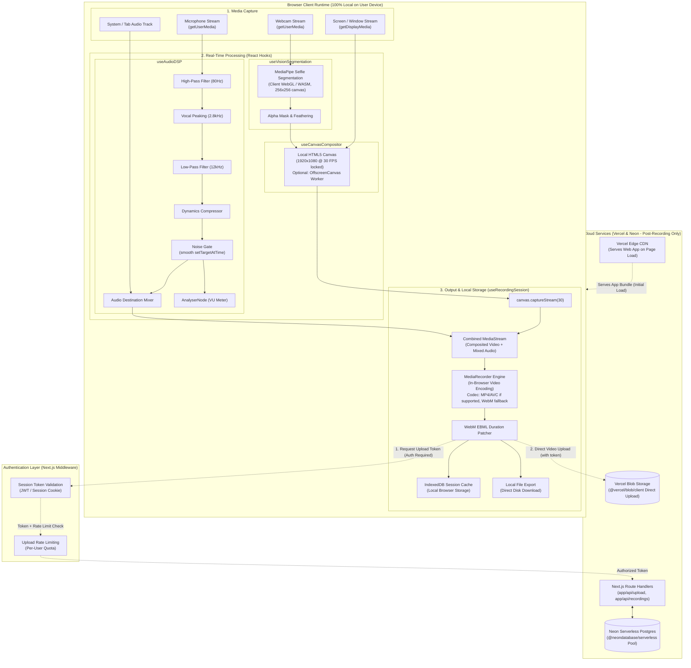
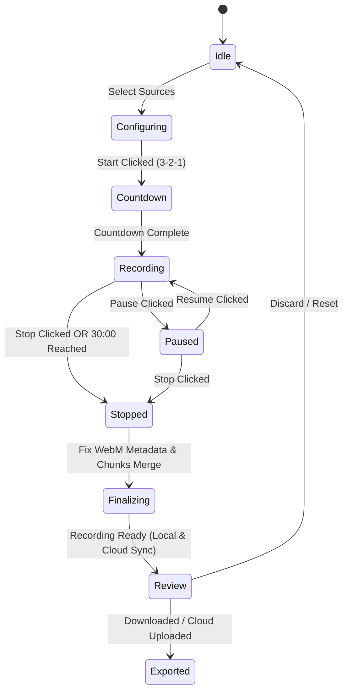

# System Architecture & Technical Design

## 1. High-Level Architecture Overview

RecordWeb is built with **Next.js (App Router)**, **React**, and **TypeScript**, operating via a high-performance hybrid architecture:
- **Client-Side Core (React + TypeScript)**: 100% of real-time media acquisition, WebGL neural vision segmentation, Web Audio DSP filtering, 30 FPS canvas compositing, and WebM encoding run locally inside the user's browser for zero latency and privacy.
- **Serverless Cloud Layer (Next.js Route Handlers + Vercel)**: Hosted on **Vercel** with Next.js App Router API handlers (`src/app/api/*`) connected to **Neon Serverless Postgres** for recording metadata and **Vercel Blob** for direct client-to-edge video object storage.
- **Authentication Layer**: All cloud interactions (upload tokens, DB writes, share links) are gated behind an authentication session. Unauthenticated requests are rejected at the Route Handler level.



---

## 2. Core Architectural Subsystems

### 2.1 Media Acquisition Hook (`useMediaDevices.ts`)
* **Role**: Initializes, configures, and monitors hardware devices (cameras, displays, microphones).
* **Key Responsibilities**:
  * Requesting screen capture with custom resolution preferences (`1920x1080` standard, frame rate `30fps`).
  * Requesting camera capture with user-selected video inputs (`deviceId`).
  * Requesting microphone stream with configurable audio constraints (`echoCancellation`, `noiseSuppression`, `autoGainControl`).
  * Handling device hot-plugging, permission revocations, and track `ended` events (e.g. user clicking "Stop Sharing" on Chrome's floating bar).
  * Strict memory cleanup: invoking `track.stop()` on unmount or stream re-acquisition.

### 2.2 Visual Compositing Engine (`useCanvasCompositor.ts`)
* **Role**: Blends multiple video feeds into a single coherent 30fps video stream.
* **Layout Modes**:
  1. **Screen Only**: Screen feed scaled to canvas preserving aspect ratio with letterboxing/pillarboxing if needed.
  2. **Webcam Only**: Centered camera feed with optional background blur or virtual background.
  3. **Picture-in-Picture (PiP Studio)**: Full-size screen capture with overlay camera bubble.
     * Shape: Circular badge, rounded rectangle, or cutout silhouette (AI background removed).
     * Position: Configurable (Bottom-Right, Bottom-Left, Top-Right, Top-Left, or custom drag position).
     * Sizing: Small (160px), Medium (240px), Large (320px).
* **Render Loop**:
  * Employs `requestAnimationFrame` with precise **timestamp delta enforcement** to guarantee a steady 30 FPS.
  * Frame is only drawn when the accumulated delta exceeds 33.33ms — preventing unbounded renders and throttling when the tab is hidden.
  * Outputs via `canvas.captureStream(30)`.
* **Risk 2 Mitigation (Thread Overload)**:
  * MediaPipe inference runs on a **downscaled 256×256 offscreen canvas** via WebGL/WASM, separate from the main 1920×1080 compositing canvas.
  * If the main thread canvas causes stutter under profiling, migrate the render loop to an **`OffscreenCanvas` inside a dedicated Web Worker**, completely freeing the React UI thread.

### 2.3 Neural Vision & Segmentation Engine (`useVisionSegmentation.ts`)
* **Role**: Extracts the human silhouette from the webcam feed in real time.
* **Technology**: MediaPipe Selfie Segmentation model running client-side via WebGL/WASM.
* **Operational Modes**:
  * **Original**: Unaltered webcam feed.
  * **Background Blur**: Blurs pixels outside the subject mask using canvas filter `blur(12px)`.
  * **Background Removal (Transparent PiP)**: Masks out background pixels completely, rendering the subject floating directly above screen content.
  * **Virtual Background**: Draws custom image, gradient, or solid color behind the subject mask.
* **Performance**: Inference canvas is always scaled to **256×256** before running segmentation. The resulting mask is upscaled and composited onto the full 1920×1080 canvas output.

### 2.4 Web Audio DSP Pipeline (`useAudioDSP.ts`)
* **Role**: Mixes, filters, enhances, and analyzes audio signals before recording.
* **Node Topology**:
  ```
  MicInput 
    └─► BiquadFilter (High-pass 80Hz) 
          └─► BiquadFilter (Peaking 2.8kHz +4dB) 
                └─► BiquadFilter (Low-pass 12kHz) 
                      └─► DynamicsCompressorNode 
                            └─► NoiseGate (GainNode — smooth setTargetAtTime)
                                  ├─► AnalyserNode (Visualizer / VU Meter)
                                  └─► MasterAudioDestination (Mixer)
  
  SystemAudio (from getDisplayMedia)
    └─► GainNode (Volume adjustment)
          └─► MasterAudioDestination (Mixer)
  ```
* **Risk 4 Mitigation (Noise Gate Popping)**:
  * Gate open (signal above threshold): `gainNode.gain.setTargetAtTime(1.0, ctx.currentTime, 0.010)` — ~10ms attack.
  * Gate close (signal below threshold): `gainNode.gain.setTargetAtTime(0.0, ctx.currentTime, 0.100)` — ~100ms release.
  * NEVER use `gain.value = 0` step changes — these cause sharp discontinuities that produce audible clicking/popping artifacts.

### 2.5 Recording State Machine (`useRecordingSession.ts`)
* **State Transition Model**:



* **Risk 3 Mitigation (A/V Desync over Long Recordings)**:
  * The canvas frame loop must be driven by a **steady delta-clamped RAF timer**. Raw `requestAnimationFrame` throttles when the browser tab is hidden, starving the canvas stream and causing video to fall behind audio.
  * A session timer fires `stopRecording()` hard at **30 minutes** to prevent unchecked clock drift.
  * UI prominently warns users when a session exceeds 15 minutes, recommending shorter sessions for best sync quality.

### 2.6 Persistence & Local Storage Subsystem (`idb.ts` & `ebmlPatcher.ts`)
* **Chunk Aggregation**: Gathers data chunks emitted during `mediaRecorder.ondataavailable` (emitted every 1000ms for safety).
* **Metadata Repair**: Standard browser `MediaRecorder` writes `Duration: 0` or NaN to WebM EBML headers for live streams. The patcher parses EBML elements and injects the exact recorded duration, making the resulting video fully seekable in all players.
* **Session Cache (IndexedDB)**: Stores the recorded blob in IndexedDB `RecordingsStore` with unique recording metadata to prevent accidental loss upon browser reload.
* **Direct Local Export**: Allows users to download the video file immediately to their local drive as `.webm`.

### 2.7 Cloud Video Storage Subsystem (Vercel Blob)
* **Role**: Object storage for hosting recorded video files and generating shareable playback links.
* **Direct Client Upload Architecture**:
  * Standard serverless functions have a 4.5MB request payload limit. Because recorded videos can reach 50MB - 150MB+, RecordWeb uses `@vercel/blob/client`.
  * **Upload Protocol** (Risk 5 auth-gated):
    1. Client invokes Next.js route `/api/upload` with a valid auth session to request an authorized upload client token.
    2. Route Handler validates the user session and enforces per-user rate limits before issuing the token.
    3. Client streams the binary video blob directly from the browser to Vercel's global edge blob storage via `upload()` from `@vercel/blob/client`.
    4. Vercel Blob returns a permanent public HTTPS video URL.
    5. The resulting `storage_url` is stored in Neon Postgres alongside recording metadata.
* **Future Upgrade Path**: If Vercel Blob bandwidth costs grow, swap for **Cloudflare R2** via S3 presigned URLs (zero egress fees).

### 2.8 Cloud Database Subsystem (Neon Serverless Postgres)
* **Role**: Relational database for recording metadata catalogs, studio presets, and share links.
* **Connection Strategy**:
  * Utilizes `@neondatabase/serverless` over WebSockets / HTTP pooling in `src/lib/db.ts`.
  * Auto-scales compute from zero with zero connection pool exhaustion.
* **Database Schema Design** (Risk 5 updated — includes `user_id`, `is_public`, `blob_pathname`):
  ```sql
  -- Users table (managed by Auth provider, mirrored here for relational integrity)
  CREATE TABLE users (
      id VARCHAR(128) PRIMARY KEY,         -- Clerk / Auth.js User ID
      email VARCHAR(255) UNIQUE NOT NULL,
      display_name VARCHAR(100),
      created_at TIMESTAMP WITH TIME ZONE DEFAULT NOW()
  );

  -- Recordings metadata table
  CREATE TABLE recordings (
      id UUID PRIMARY KEY DEFAULT gen_random_uuid(),
      user_id VARCHAR(128) NOT NULL REFERENCES users(id) ON DELETE CASCADE,
      title VARCHAR(255) NOT NULL,
      duration_seconds REAL NOT NULL,
      file_size_bytes BIGINT NOT NULL,
      resolution VARCHAR(32) NOT NULL DEFAULT '1920x1080',
      fps INTEGER NOT NULL DEFAULT 30,
      mime_type VARCHAR(64) NOT NULL DEFAULT 'video/webm',
      local_id VARCHAR(128),
      storage_url TEXT NULL,               -- Vercel Blob CDN public URL
      blob_pathname TEXT NULL,             -- Vercel Blob pathname for deletions (del(pathname))
      is_public BOOLEAN DEFAULT FALSE,     -- Share link visibility toggle
      settings JSONB DEFAULT '{}'::jsonb,
      created_at TIMESTAMP WITH TIME ZONE DEFAULT NOW()
  );
  CREATE INDEX idx_recordings_user_id ON recordings(user_id);

  -- Studio presets table (per-user)
  CREATE TABLE studio_presets (
      id UUID PRIMARY KEY DEFAULT gen_random_uuid(),
      user_id VARCHAR(128) NOT NULL REFERENCES users(id) ON DELETE CASCADE,
      preset_name VARCHAR(100) NOT NULL,
      pip_shape VARCHAR(32) DEFAULT 'circle',
      pip_size VARCHAR(32) DEFAULT 'medium',
      pip_position VARCHAR(32) DEFAULT 'bottom-right',
      bg_removal_mode VARCHAR(32) DEFAULT 'blur',
      filters_config JSONB DEFAULT '{}'::jsonb,
      updated_at TIMESTAMP WITH TIME ZONE DEFAULT NOW()
  );
  CREATE INDEX idx_presets_user_id ON studio_presets(user_id);
  ```

### 2.9 Authentication & Access Control Layer
* **Provider**: **Clerk** (recommended) or **NextAuth/Auth.js** — integrates natively with Next.js App Router Middleware.
* **Session Enforcement**:
  * Next.js Middleware (`middleware.ts`) validates session tokens on all `/api/*` routes before the Route Handler executes.
  * Route Handlers extract `userId` from the verified session and scope all DB queries to that `user_id`.
  * Anonymous or expired sessions receive `401 Unauthorized` responses.
* **Upload Rate Limiting**:
  * The `/api/upload` Route Handler enforces per-user upload rate limits (e.g., max 10 uploads/hour) to prevent blob storage quota abuse.
* **Public Share Links**:
  * A recording with `is_public = TRUE` is accessible via a public route (e.g., `/share/[recordingId]`).
  * The share route reads metadata from Neon and serves the Vercel Blob URL — no auth required for read-only playback.

### 2.10 Codec & Browser Compatibility Strategy
* **Risk 1 Mitigation (Safari / Apple WebM Playback)**:
  * On session start, detect codec support: `MediaRecorder.isTypeSupported('video/mp4;codecs=avc1,mp4a.40.2')`.
  * If MP4/AVC is supported (Chromium 130+), prefer `video/mp4` as the `MediaRecorder` MIME type. Fall back to `video/webm;codecs=vp9,opus`.
  * Store the actual `mime_type` in the `recordings` table so the client and player know which container to expect.
  * For shared videos played in Safari, the public `/share/[recordingId]` page includes `<source>` fallbacks and displays a "Best viewed in Chrome" notice if the stored MIME type is WebM.
  * **Advanced (Future)**: Integrate an async cloud transcode step (via a Vercel background function) to convert WebM → MP4 post-upload if cross-platform sharing becomes a primary feature.

### 2.11 Next.js Project Structure & App Router Architecture

```text
src/
├── app/
│   ├── layout.tsx                    # Root layout with font and metadata
│   ├── page.tsx                      # Studio main page ("use client")
│   ├── globals.css                   # Glassmorphic design tokens and reset
│   ├── middleware.ts                 # Auth session validation for /api/* routes
│   ├── share/
│   │   └── [recordingId]/page.tsx   # Public share page (read-only, no auth required)
│   └── api/
│       ├── upload/
│       │   └── route.ts              # Vercel Blob client upload token generation
│       ├── recordings/
│       │   └── route.ts              # Neon DB recording metadata CRUD
│       └── presets/
│           └── route.ts              # Neon DB studio presets CRUD
├── components/
│   ├── studio/
│   │   ├── StudioStage.tsx           # 16:9 Live Canvas preview + overlays
│   │   ├── ControlDock.tsx           # Floating REC bar, timer, pause/resume
│   │   ├── SourceSelector.tsx        # Screen / Camera / PiP selector
│   │   ├── FilterPanel.tsx           # DSP sound filter toggles and gain
│   │   ├── CameraSettings.tsx        # PiP shape, size, background mode
│   │   ├── VuMeter.tsx               # Audio levels visualizer
│   │   └── CountdownOverlay.tsx      # 3-2-1 animated countdown
│   └── review/
│       ├── ReviewModal.tsx           # Video playback player and export buttons
│       └── RecordingsDrawer.tsx      # Dual-tab local IndexedDB & cloud history
├── hooks/
│   ├── useMediaDevices.ts            # Screen & camera stream lifecycle
│   ├── useCanvasCompositor.ts        # 30 FPS composition loop & PiP layout
│   ├── useAudioDSP.ts                # Web Audio graph & DSP filtering
│   ├── useVisionSegmentation.ts      # MediaPipe AI background removal
│   └── useRecordingSession.ts        # MediaRecorder lifecycle & 5-min timer
├── lib/
│   ├── db.ts                         # Neon Postgres client via @neondatabase/serverless
│   ├── ebmlPatcher.ts                # Binary EBML duration patcher
│   └── idb.ts                        # IndexedDB wrapper for session backup
└── types/
    ├── media.ts                      # Stream and filter configuration types
    ├── recording.ts                  # Recording metadata and chunk types
    └── database.ts                   # Neon DB model interfaces
```

---

## 3. Risk Mitigation Summary

| Risk | Description | Status | Solution |
| :--- | :--- | :--- | :--- |
| **R1: Safari WebM Playback** | Safari can't play WebM/Opus blobs | Mitigated | Detect MP4/AVC support at runtime; prefer MP4; fallback gracefully; show compatibility notice on share page |
| **R2: Main Thread Overload** | 1080p canvas + MediaPipe + React on one thread | Mitigated | MediaPipe runs on downscaled 256×256 canvas; OffscreenCanvas Worker upgrade path defined |
| **R3: A/V Desync** | Clock drift between canvas stream and AudioContext over long recordings | Mitigated | Steady delta-clamped RAF timer; 30-min hard stop; UI warns at 15 min |
| **R4: Noise Gate Popping** | Abrupt `gain.value = 0` causes audible clicks | Mitigated | Use `setTargetAtTime` with 10ms attack / 100ms release envelope |
| **R5: Missing Auth & Access Control** | Any user could access any recording or spam uploads | Mitigated | Auth middleware on all `/api/*` routes; `user_id` FK in all tables; per-user rate limiting |

---

## 4. Data Flow & Latency Targets

| Pipeline Step | Target Latency / Cadence | Technique |
| :--- | :--- | :--- |
| Screen Capture Render | < 16ms | Direct Canvas `drawImage(videoElement)` |
| MediaPipe AI Segmentation | < 25ms per frame | Downscaled inference canvas (256x256), WebGL backend |
| Audio Filtering & Mixing | < 5ms | Native Web Audio API native thread |
| Canvas Stream Encoding | 30.0 FPS locked | Delta-clamped RAF + `canvas.captureStream(30)` |
| Video Chunk Flush | Every 1,000ms | `mediaRecorder.start(1000)` |
| Duration Patcher | < 150ms post-stop | In-memory binary EBML buffer scan |
| Vercel Blob Upload | Bandwidth dependent | Direct client-to-edge stream via `@vercel/blob/client` (auth-gated token) |
| Neon DB Metadata Sync | < 100ms | HTTP connection pooling via `@neondatabase/serverless` |
