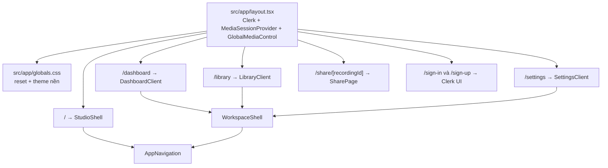

# Phân tích phạm vi UI và tác động khi xây dựng lại giao diện RecordWeb

> Cập nhật: 15/10/2026  
> Phạm vi khảo sát: `src/app`, `src/components`, các CSS Module liên quan và `extension/`  
> Mục tiêu: xác định chính xác phần nào đang tạo nên UI, phần nào chỉ nhìn giống UI nhưng đang chứa logic nghiệp vụ, và cách redesign mà không làm hỏng pipeline ghi hình.

## 1. Kết luận ngắn

UI của RecordWeb hiện được chia thành ba lớp:

1. **Khung ứng dụng dùng chung**: root layout, theme, navigation và workspace shell.
2. **UI theo từng màn hình**: Studio, Dashboard, Library, Settings, Share và Authentication.
3. **UI tương tác chuyên biệt**: điều khiển thiết bị toàn cục, VU meter, waveform và cursor trajectory.

Phần có rủi ro cao nhất vẫn là Studio, nhưng trách nhiệm đã được tách thành hai lớp: `StudioShell.tsx` chỉ composition các vùng giao diện, còn `useStudioController.ts` điều phối camera/screen/microphone, compositor, AI segmentation, audio DSP, MediaRecorder, IndexedDB recovery, upload Blob, preset và diagnostics. Vì vậy:

- Có thể thay đổi **màu sắc, typography, spacing, responsive layout và CSS** với rủi ro tương đối thấp.
- Có thể thay đổi **DOM/JSX** nếu giữ nguyên ref, event handler, state transition và thứ tự provider/hook.
- Có thể thay từng component UI độc lập, nhưng không nên thay đổi contract của `useStudioController` hoặc các hook media dưới danh nghĩa redesign. Làm vậy có thể làm hỏng recording lifecycle dù màn hình vẫn render bình thường.

`extension/` hiện **không có popup hoặc options page**. Click vào extension action chỉ kích hoạt capture thông qua service worker; do đó redesign web UI không cần và không nên sửa các file extension.

## 2. Bản đồ UI hiện tại

Lưu ý: Studio dùng `AppNavigation` nhưng có shell/layout riêng; Dashboard, Library và Settings dùng chung `WorkspaceShell`.

## 3. Danh sách file đang đảm nhiệm UI

### 3.1. Nền tảng và shell dùng chung

| File | Trách nhiệm UI | Mức ảnh hưởng khi sửa |
| --- | --- | --- |
| `src/app/layout.tsx` | Font Geist, metadata, theme bootstrap trước hydrate, Clerk provider, media provider và global media control | **Rất cao** nếu đổi provider/order; thấp nếu chỉ đổi metadata hoặc class bao ngoài |
| `src/app/globals.css` | Reset toàn cục, `body`, màu nền/chữ gốc, `color-scheme` light/dark | **Toàn ứng dụng** |
| `src/components/app/AppNavigation.tsx` | Thanh điều hướng Studio/Dashboard/Library/Settings, Clerk `UserButton` | Cao: tác động mọi màn hình authenticated |
| `src/components/app/AppNavigation.module.css` | Sidebar desktop và bottom navigation mobile | Toàn bộ navigation/responsive |
| `src/components/app/WorkspaceShell.tsx` | Khung trang dùng chung: navigation, header, actions và content | Cao: Dashboard, Library, Settings |
| `src/components/app/WorkspaceShell.module.css` | Token màu chính của workspace, shell grid, page header, theme light/dark, breakpoint mobile | **Rất rộng**: đây đang là design-token scope cho ba route |

### 3.2. Studio và recording workspace

| File | Trách nhiệm UI | Logic đang gắn trực tiếp |
| --- | --- | --- |
| `src/app/page.tsx` | Route `/`, chỉ render `StudioShell` | Gần như không có logic |
| `src/app/presentation/page.tsx` | Route `/presentation`, render `PresentationShell` độc lập | Dùng controller ở chế độ presentation; không thay UI route `/` |
| `src/components/studio/StudioShell.tsx` | Composition root của Studio; lắp navigation, header, toolbar, notice, workspace/review và diagnostics | Không còn chứa processing; gọi `useStudioController()` một lần và phân phối controller cho các view |
| `src/components/studio/PresentationShell.tsx` | Bản sao composition của Studio dành cho slide | Reuse chrome/review/diagnostics/effects; lắp source panel và stage riêng |
| `src/components/studio/PresentationStage.tsx` | Slide canvas, raw webcam, custom cursor, slide navigation và recording dock | Giữ `presentationElement` ref làm Element Capture root; full-tab fallback chuyển root thành clean viewport |
| `src/components/studio/PresentationSourcesPanel.tsx` | Trạng thái deck, camera/microphone và output | Không expose screen-share/extension source trong presentation route |
| `src/components/studio/useStudioController.ts` | Sở hữu state/effect/action và điều phối toàn bộ media + persistence + cloud flow | **Rất cao**: giữ thứ tự hook, async semantics, cleanup và state transition |
| `src/components/studio/studioConfig.ts` | Type, option list, MIME/extension, asset và duration helper dùng chung | Trung bình: một số helper tham gia upload/download contract |
| `src/components/studio/StudioChrome.tsx` | Header, theme/diagnostics actions, panel toolbar và session notice | Presentation + phát event qua controller |
| `src/components/studio/StudioSourcesPanel.tsx` | Capture mode, device selection, source status và output resolution | UI trực tiếp phát lệnh acquire/stop qua controller |
| `src/components/studio/StudioStage.tsx` | Canvas preview, countdown và recording control dock | Giữ nguyên canvas ref/pointer handlers và start/pause/resume/stop actions |
| `src/components/studio/StudioEffectsPanel.tsx` | Camera/AI, audio DSP và preset controls | UI phát thay đổi compositor/audio/preset qua controller |
| `src/components/studio/StudioReviewWorkspace.tsx` | Review video, waveform, cursor, source download, upload/publish actions | Presentation của finalized assets và cloud state |
| `src/components/studio/StudioDiagnosticsDrawer.tsx` | Preflight capability/service drawer | Presentation của health/capability state |
| `src/components/studio/StudioPrimitives.tsx` | Icon SVG và status dot dùng trong Studio | Rủi ro thấp |
| `src/components/studio/StudioShell.module.css` | Layout và toàn bộ visual Studio; gần 2.000 dòng CSS, gồm responsive drawers, stage, controls, review và diagnostics | Class name được dùng bởi các Studio view; đổi tên phải sửa đồng bộ consumer |
| `src/components/studio/AudioLevelMeter.tsx` | Thanh mức âm lượng và trạng thái audio | Nhận trạng thái DSP; cách hiển thị phụ thuộc mức tín hiệu thực |
| `src/components/studio/AudioLevelMeter.module.css` | Màu, chuyển động và layout VU meter | Thấp nếu chỉ chỉnh visual |
| `src/components/studio/AudioMeterPanel.tsx` | Gom microphone/system meter; Standard Studio chỉ hiển thị thanh microphone trong `StudioSourcesPanel`, Presentation giữ cả hai và chế độ collapse/expand | Có local interaction state ở chế độ Presentation |
| `src/components/studio/AudioMeterPanel.module.css` | Panel và responsive meter | Thấp đến trung bình |

### 3.3. Dashboard, Library và Settings

| File | Trách nhiệm UI | Logic không được làm mất khi redesign |
| --- | --- | --- |
| `src/app/dashboard/page.tsx` | Route wrapper cho Dashboard | Giữ render `DashboardClient` |
| `src/components/dashboard/DashboardClient.tsx` | Stats, recovery banner, quick start, recent recordings, presets | Fetch `/api/recordings`, `/api/presets`; đọc IDB; xóa preset; ghi `recordweb-quick-start` và `recordweb-pending-preset` vào `localStorage` |
| `src/components/dashboard/DashboardClient.module.css` | Card/grid/list và responsive Dashboard | Có thể redesign presentation |
| `src/app/library/page.tsx` | Route wrapper cho Library | Giữ render `LibraryClient` |
| `src/components/library/LibraryClient.tsx` | Danh sách cloud sở hữu/được chia sẻ, preview, download, delete, public link và recipient sharing | `/api/recordings`, `/api/shares`, Blob URLs, quyền owner/viewer/download; IndexedDB vẫn dùng cho khôi phục ngoài Library |
| `src/components/library/LibraryClient.module.css` | Grid recording, modal preview/share và responsive | Có thể redesign presentation; phải giữ overlay/modal usable |
| `src/app/settings/page.tsx` | Route wrapper cho Settings | Giữ render `SettingsClient` |
| `src/components/settings/SettingsClient.tsx` | Theme selection, local storage stats, health check và privacy explanation | `recordweb-theme`, DOM `data-theme`, IDB, `/api/health` |
| `src/components/settings/SettingsClient.module.css` | Settings cards, theme preview và responsive | Có thể redesign presentation |

### 3.4. Review, playback và trực quan hóa

| File | Trách nhiệm UI | Rủi ro |
| --- | --- | --- |
| `src/components/review/RecordedAudioWaveform.tsx` | Waveform, playback và click-to-seek | Trung bình: UI gắn với audio element/time state |
| `src/components/review/useRecordedAudioWaveform.ts` | Hook xử lý playback/decode state cho waveform | **Không phải presentation-only** |
| `src/components/review/RecordedAudioWaveforms.tsx` | Gom/collapse mixed, microphone và system waveform | Trung bình |
| `src/components/review/RecordedCursorTrajectory.tsx` | Player cho cursor trajectory, seek, tốc độ và trail | Trung bình đến cao: có animation/playback state |
| Các `*.module.css` cùng thư mục | Visual của waveform và cursor player | Thấp nếu không đổi cấu trúc tương tác |

### 3.5. Media control toàn cục

| File | Trách nhiệm UI | Rủi ro |
| --- | --- | --- |
| `src/components/media/GlobalMediaControl.tsx` | Panel nổi “Devices in use”, ngắt từng nguồn hoặc tất cả | **Cao**: nút UI trực tiếp dừng MediaStream track |
| `src/components/media/GlobalMediaControl.module.css` | Panel nổi, dragging, theme và responsive | Trung bình |
| `src/components/media/usePersistentPanelPosition.ts` | Kéo/thả, keyboard movement, viewport clamp và lưu vị trí | Không phải CSS/UI thuần; giữ contract khi đổi panel |
| `src/components/media/MediaSessionProvider.tsx` | Chủ sở hữu media session dùng chung giữa các route | **Protected/core behavior**; không sửa chỉ để redesign |

### 3.6. Share và Authentication

| File | Trách nhiệm UI | Rủi ro |
| --- | --- | --- |
| `src/app/share/[recordingId]/page.tsx` | Public/private share player, metadata, source downloads | **Rất cao**: đây là Server Component thực hiện Clerk auth và query quyền truy cập trực tiếp |
| `src/app/share/[recordingId]/share.module.css` | Toàn bộ visual share page | Có thể redesign CSS; không được làm suy yếu `canDownload`/access checks |
| `src/app/sign-in/[[...sign-in]]/page.tsx` | Bọc Clerk `SignIn` | Giữ catch-all route và Clerk component |
| `src/app/sign-up/[[...sign-up]]/page.tsx` | Bọc Clerk `SignUp` | Giữ catch-all route và Clerk component |
| `src/app/auth.module.css` | Căn giữa/loading state cho auth pages | Thấp; giao diện form chính do Clerk render |

### 3.7. File liên quan nhưng không phải UI cần redesign

- `extension/manifest.json`, `recordweb-bridge.js`, `tracker-content.js`, `service-worker.js`: không render web UI. Manifest cũng không khai báo `default_popup` hay options page.
- `src/hooks/*`: pipeline capture/compositor/audio/recording; là protected behavior.
- `src/lib/*`: IndexedDB, EBML repair, waveform utilities, database/auth helpers; không phải presentation.
- `src/app/api/*`: API contract; không thuộc phạm vi UI redesign.
- `src/types/*`: contract dữ liệu; chỉ đổi khi có thay đổi nghiệp vụ được phê duyệt.
- `public/frame-ticker-worker.js`: clock cho frame pipeline; tuyệt đối không coi là asset UI.
- Các SVG template mặc định `file.svg`, `globe.svg`, `next.svg`, `vercel.svg`, `window.svg` đã được xóa sau khi audit xác nhận không có consumer.

## 4. Technical debt UI nên xử lý trước hoặc trong redesign

1. **Đã tách `StudioShell.tsx`**: shell hiện chỉ còn khoảng 40 dòng composition; processing nằm trong `useStudioController.ts` và UI được chia theo vùng chức năng. Rủi ro chính đã chuyển sang contract giữa controller và các view.
2. **`useStudioController.ts` vẫn là processing coordinator lớn**: đây là chủ đích để giữ nguyên thứ tự hook và async lifecycle trong lần refactor đầu. Chỉ nên tách tiếp recovery/upload/preset sau khi có characterization tests cho các flow đó.
3. **`StudioShell.module.css` vẫn lớn**: khoảng 1.700 dòng sau khi đã xóa hơn 300 dòng selector không còn consumer; nên tiếp tục tách theo view khi bắt đầu redesign thực tế.
4. **Token theme bị phân tán**:
   - `globals.css` chỉ có `--background` và `--foreground`.
   - `WorkspaceShell.module.css` định nghĩa bộ token riêng cho Dashboard/Library/Settings.
   - `StudioShell.module.css` có scope token/layout riêng cho Studio.
   - Share/Auth lại có style độc lập.
   Việc đổi branding hiện phải sửa nhiều nơi và dễ lệch light/dark theme.
5. **Đã xóa CSS navigation cũ** khỏi `StudioShell.module.css`; navigation hiện chỉ do `AppNavigation.tsx` và `AppNavigation.module.css` sở hữu.
6. **Đã xóa `src/app/page.module.css`** sau khi xác nhận không có import; đây là CSS template Next.js không còn được sử dụng.
7. **Icon SVG được viết inline** ở nhiều component (`AppNavigation`, `StudioPrimitives`, `GlobalMediaControl`), khiến đổi icon system tốn công và dễ thiếu nhất quán.
8. **Breakpoint phân tán** giữa các CSS Module; cần gom thành chiến lược responsive chung thay vì thay từng màn hình độc lập.

## 5. Redesign sẽ ảnh hưởng những gì?

### 5.1. Ảnh hưởng chắc chắn

- Tất cả route người dùng nhìn thấy: `/`, `/dashboard`, `/library`, `/settings`, `/share/[recordingId]`, `/sign-in`, `/sign-up`.
- Light/dark theme, navigation desktop/mobile và focus/hover/disabled/error/loading states.
- Responsive behavior của studio drawers, preview 16:9, control dock, modal library và floating device panel.
- Accessibility: tab order, focus-visible, ARIA labels/live regions, keyboard shortcuts và độ tương phản.

### 5.2. Ảnh hưởng gián tiếp nếu thay JSX/component boundary

- **Recording lifecycle**: countdown, start, pause, resume, stop, processing và review.
- **Canvas**: `canvas` ref, kích thước hiển thị, pointer drag PiP và keyboard nudge.
- **Media permissions/cleanup**: connect/disconnect sources, stop track khi thay nguồn hoặc unmount.
- **Audio**: mute, gain, preset DSP, mixed/source meter và audio context resume.
- **Recovery**: phát hiện draft, recovery, reset review và object URL lifecycle.
- **Cloud flow**: direct-to-Blob upload, metadata POST, upload progress, visibility/share controls.
- **Cross-route setup**: quick-start/preset truyền sang Studio bằng hai `localStorage` key.
- **Authorization**: download/share action phải tiếp tục dựa trên quyền server trả về, không chỉ ẩn bằng CSS.

### 5.3. Thành phần không nên bị ảnh hưởng bởi redesign presentation-only

- `src/hooks/useMediaDevices.ts`
- `src/hooks/useCanvasCompositor.ts`
- `src/hooks/useAudioDSP.ts`
- `src/hooks/useVisionSegmentation.ts`
- `src/hooks/useRecordingSession.ts`
- `src/hooks/useNormalizedVideoStream.ts`
- `src/hooks/useCursorTrajectory.ts`
- `src/hooks/useTabCaptureExtension.ts`
- `src/hooks/usePresentationDeck.ts`
- `src/hooks/usePresentationTabCapture.ts`
- `src/hooks/usePresentationCursor.ts`
- `src/hooks/usePresentationRecordingSource.ts`
- `src/lib/presentation/*`
- `src/lib/idb.ts`, `src/lib/ebmlPatcher.ts`, `src/lib/db.ts`
- `src/app/api/*`, database migrations và upload/storage contract
- Toàn bộ `extension/`

Nếu thiết kế mới thực sự đòi thay đổi một trong các phần trên, đó không còn là “UI-only redesign”; cần phân tích riêng và phê duyệt rõ phạm vi/rủi ro trước khi làm.

## 6. Những contract phải giữ nguyên

| Khu vực | Contract cần giữ |
| --- | --- |
| Root | `ClerkProvider` bọc `MediaSessionProvider`; `GlobalMediaControl` vẫn ở trong media provider |
| Theme | `html[data-theme]` và key `recordweb-theme`; bootstrap trước hydrate để tránh flash sai theme |
| Navigation | Route `/`, `/dashboard`, `/library`, `/settings`; active state và `UserButton` |
| Studio stage | Canvas/ref, tỷ lệ 16:9, pointer/keyboard PiP interaction, preview tiếp tục chạy đúng trạng thái |
| Presentation stage | Presentation root/ref phải chứa slide, raw webcam và custom cursor; self-tab capture chỉ bắt đầu từ user gesture và UI không tự dừng/chiếm ownership của capture tracks |
| Recording controls | Start/countdown/pause/resume/stop, trạng thái disabled, cảnh báo 15/29/30 phút và `aria-live` |
| Shortcuts | Space/Alt+P pause-resume, Alt+S stop, Alt+M mute, Alt+C camera; bỏ qua khi focus vào input/editable |
| Dashboard → Studio | `recordweb-quick-start`, `recordweb-pending-preset` và navigation về `/` |
| Recovery | Draft banner, recover latest, reset review và download repaired assets |
| Upload | Client upload trực tiếp với `@vercel/blob/client`; không chuyển file media qua API body |
| Library | Bộ lọc bài giảng sở hữu/được chia sẻ từ cloud; preview/download/delete/share; xác nhận destructive action |
| Share page | Request-time auth/query, `canDownload`, private-by-default và không lộ metadata khi unauthorized |
| Media control | Dừng đúng từng source/all; drag, keyboard move, clamp viewport và persisted position |

## 7. Phân loại phạm vi thay đổi theo rủi ro

### Mức A — Presentation-only, nên bắt đầu từ đây

- CSS variables/design tokens.
- Font size, spacing, color, border, shadow, radius, animation.
- Grid/flex layout và breakpoint, miễn canvas/control vẫn usable.
- Copy/label và icon visual, miễn không đổi ý nghĩa action/ARIA.
- Sắp xếp lại section bằng CSS hoặc wrapper presentation không làm mất ref/handler.

### Mức B — Structural UI, cần regression test đầy đủ

- Tách `StudioShell` thành các presentational component.
- Thay navigation hoặc workspace shell.
- Di chuyển modal/drawer sang portal.
- Thay form control, tabs, collapsible panels hoặc DOM order.
- Thay component waveform/cursor player.

### Mức C — Behavioral/core, nằm ngoài redesign UI mặc định

- Thay hook, state machine hoặc provider ownership.
- Thay API payload/response, upload flow, DB query/schema hoặc auth check.
- Thay canvas render loop, AudioContext graph, MediaRecorder lifecycle hoặc track cleanup.
- Thay extension capture/bridge/service worker.

## 8. Chiến lược “đập đi xây lại” an toàn

### Giai đoạn 0 — Chốt contract trước khi đổi giao diện

- Chụp baseline cho desktop/tablet/mobile, light/dark và mọi session state.
- Lập checklist interaction từ mục 6.
- Không thay API, hook signature, route hay storage key.

### Giai đoạn 1 — Xây design foundation

- Gom semantic token toàn cục: background/surface/text/border/accent/status/radius/shadow/motion.
- Giữ Vanilla CSS/CSS Modules; không thêm Tailwind.
- Chuẩn hóa focus, button, input, card, badge, modal và responsive breakpoints.

### Giai đoạn 2 — Redesign shell và các màn hình ít rủi ro

- Làm `AppNavigation` + `WorkspaceShell` trước.
- Sau đó Dashboard và Settings.
- Tiếp theo Library, waveform/cursor và Share/Auth.
- Mỗi route hoàn tất phải kiểm tra light/dark, mobile và keyboard.

### Giai đoạn 3 — Redesign Studio theo hướng “controller giữ nguyên, view thay mới”

- Giữ hook call/order và state trong `useStudioController`.
- Thay từng view đã tách: `StudioHeader`, `StudioSourcesPanel`, `StudioStage`, `StudioEffectsPanel`, `StudioReviewWorkspace`, `StudioDiagnosticsDrawer`.
- Các view nhận controller qua props; presentational component không tự sở hữu MediaStream hoặc gọi API/IDB.
- Chỉ xóa CSS cũ sau khi xác nhận class không còn được tham chiếu.

### Giai đoạn 4 — Dọn technical debt và kiểm thử tích hợp

- [x] Xóa `src/app/page.module.css` sau khi xác nhận không có import.
- [x] Audit/xóa navigation CSS và các prototype block không còn consumer trong Studio.
- Chuẩn hóa icon system và token theme.
- Chạy lint/build và manual media verification trước khi merge.

## 9. Ma trận kiểm thử bắt buộc sau redesign

| Nhóm | Kiểm thử tối thiểu |
| --- | --- |
| Build | `npm run lint`, `npm run build` không lỗi/cảnh báo |
| Theme | Không flash sai theme; persistence sau reload; contrast light/dark |
| Responsive | Desktop ≥ 1440, laptop 1024–1439, tablet, mobile ≤ 680; control dock không bị che |
| Sources | Camera/screen/mic connect, replace, disconnect từng nguồn và disconnect all |
| Recording | Start, countdown, pause, resume, stop, finalization, record another |
| Canvas | 30 FPS target, 16:9, PiP drag/keyboard, background original/blur/cutout |
| Audio | Meter, mute, gain, DSP preset, system audio state, không glitch |
| Recovery | Draft detection, recover latest, local download và cleanup |
| Upload | Direct Blob upload, metadata save, progress/error/retry và share link |
| Library | Bộ lọc bài giảng sở hữu/được chia sẻ từ cloud, preview, waveform/cursor, delete scope, permissions |
| Accessibility | Tab order, focus-visible, labels, live announcements và shortcut conflict |
| Cleanup | Track stop khi disconnect/unmount; không để camera/mic/tab capture tiếp tục ngoài ý muốn |

## 10. Phạm vi file khuyến nghị cho một PR redesign UI-only

Có thể sửa trực tiếp:

- `src/app/globals.css`
- `src/app/auth.module.css`
- `src/app/share/[recordingId]/share.module.css`
- `src/components/**/*.module.css`
- JSX trong `src/components/**` và các page khi chỉ thay cấu trúc presentation, giữ nguyên props/handler/state transition

Không sửa nếu chưa có yêu cầu và phê duyệt riêng:

- `src/hooks/**`
- `src/lib/**`
- `src/app/api/**`
- `src/types/**` nếu chỉ phục vụ thay visual
- `database/**`, `scripts/db-migrate.mjs`
- `src/proxy.ts`
- `extension/**`
- `next.config.ts`, biến môi trường và deployment config

## 11. Đề xuất quyết định

Có thể làm lại toàn bộ visual của RecordWeb, nhưng nên coi đây là một chương trình redesign theo từng route, không phải một lần thay thế toàn bộ `StudioShell`. Cách ít rủi ro nhất là:

1. Chuẩn hóa design token và shell dùng chung.
2. Redesign các route phụ trước.
3. Giữ `useStudioController` làm orchestrator và thay UI từng presentational component.
4. Không chạm pipeline media, API, database, storage, auth và extension trong PR UI-only.
5. Chỉ hoàn tất khi ma trận kiểm thử media + responsive + accessibility đều đạt.

